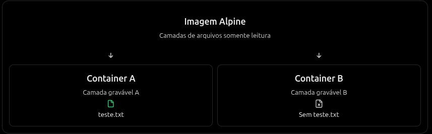

Um container possui isolamento de determinados recursos, mas continua fazendo chaamdas de sistema ao kernel do host.

## Isolamento de processos

Como visto em outros tópicos, supondo que seu sistema ubuntu tenha 100 processos ativos, se você entrar num container e executar `ps`, é provavel que veja somente os processos disponíveis do próprio container. Mas isso não significa que os outros 100 processos tenham desaparecidos. Eles continuam sendo gerenciados pelo kernel, o container apenas não tem essa visão.

## Isolamento de filesystem

É muito comum que diversas imagens que usamos contenham o próprio sistema de arquivos. Ex:

```
/
├── bin/
├── etc/
├── lib/
├── tmp/
└── usr/
```

Em casos assim, o docker fornece a própria visão do sistema de arquivos, mas não necessáriamente são os mesmos arquivos do host.

Além disso, cada container normalmente possui a própria camada para gravar informações, sobre as camadas imutáveis da imagem:



Porém, esse isolamento não é absoluto, pois podemos utilizar dos volumes e outros tipos de montagens para compartilhar arquivos
