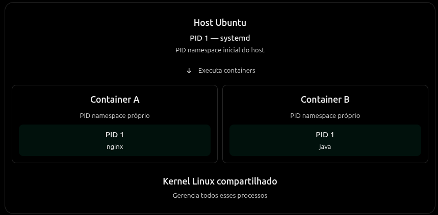

PID significa **Process ID**, em ambientes linux, cada processo tem um identificador. O kernel utiliza esse identificador para distringuir e gerenciar processos.

Exemplo: Em uma instalação convencional de uma distro como o ubuntu, o PID 1 normalmente tende a ser o [systemd](../../linux/o-que-e-systemd/).

## Mas e dentro de um container?

Como os containers normalmente utilizam isolamento de processos por meio de PID namespaces, um container pode possuir a própria visão de PID's.

O número é relativo ao namespace, portanto um processo java em um container pode ser o PID 1, mas na visão do host pode ser o PID 1234. São o mesmo processo, mas identificados de forma diferente.

Normalmente, no docker, o processo principal do container é seu PID 1. Então, se executamos um container no qual o seu principal projeto é uma aplicação java, por exemplo, este será o PID 1, e o container irá existir enquanto o seu principal PID (PID 1) estiver ativo. Quando o processo termina, o container é encerrado. Ou seja, com isso conseguimos entender que, **a vida de um container está diretamente relacionado à vida de seu processo principal (PID 1).**

## Por onde continuar?

- [O que são containers?](../o-que-sao-containers/)
- [O que são imagens Docker?](../o-que-sao-imagens-docker/)
- [O que é o Docker Engine?](../o-que-e-docker-engine/)

## Referências

- [Fontes usadas para esta página](../../../referencias/docker/)
